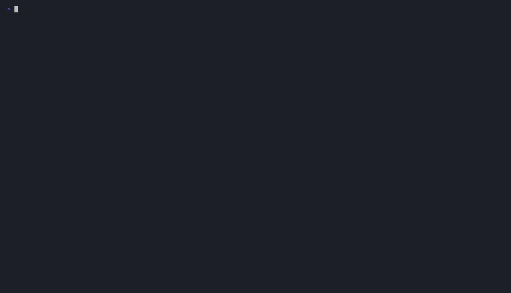
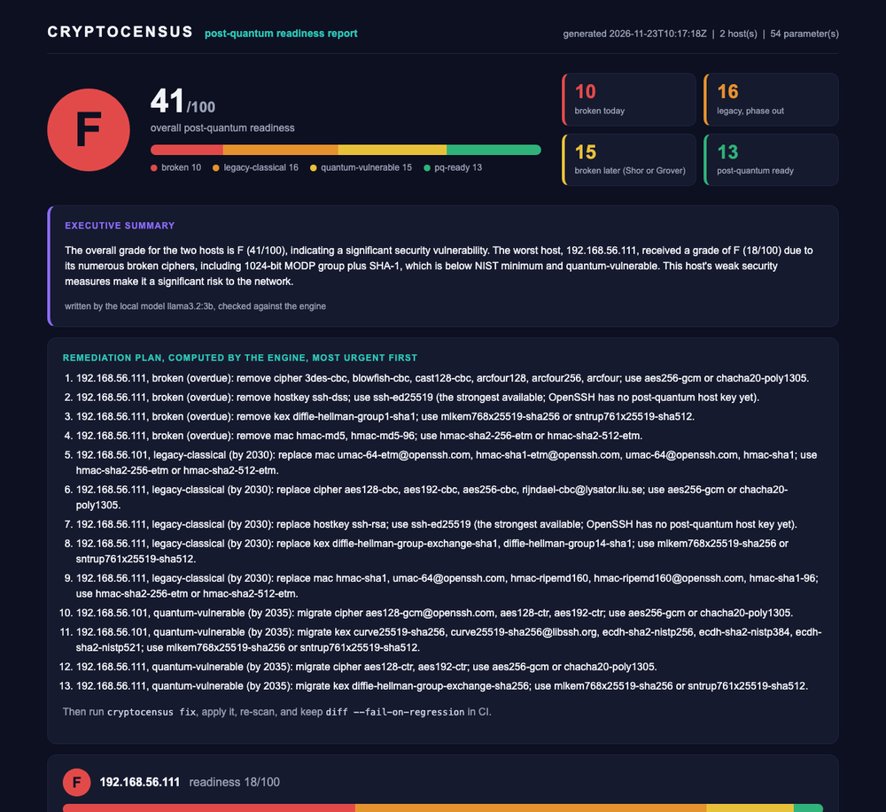

# CryptoCensus

A native crypto-posture scanner. It reads the cryptography a host advertises on
the wire, scores every algorithm for post-quantum readiness against NIST
guidance, grades the host, writes a CycloneDX 1.6 CBOM, proves the fix, and can
write the report with a local model. One Rust binary, dependency-light.

CryptoCensus is not a port scanner. It speaks SSH at the protocol level: after
the version exchange a server sends its `SSH_MSG_KEXINIT` in the clear, listing
every key exchange, host key, cipher and MAC it supports. CryptoCensus reads that
packet directly (no nmap, no crypto handshake), so a whole /24 takes about a
second.



The `report` command writes a self-contained HTML dashboard: the grade, the
readiness bands, the AI summary checked against the engine, and the
engine-computed remediation plan.



## Quick start

```
git clone https://github.com/MaqsatKendjebekov/cryptocensus && cd cryptocensus
cargo build --release
./target/release/cryptocensus selftest
./target/release/cryptocensus scan --targets 192.168.56.0/24 --out results
./target/release/cryptocensus report --out results     # then open results/heatmap.html
```

## Build

```
cargo build --release
./target/release/cryptocensus selftest
```

Pure standard library plus `serde_json`; `num-bigint` is used only by the
batch-GCD command.

## Readiness bands

Every algorithm is placed in one of four bands, each cited to a standard in
`policy.json`:

- `broken`: unsafe today with no quantum computer (RC4, 3DES, MD5, ssh-dss, 1024-bit DH).
- `legacy-classical`: deprecated, phase out (AES-CBC, HMAC-SHA1, ssh-rsa).
- `quantum-vulnerable`: safe today, broken by Shor later (curve25519, ECDH, RSA, AES-128).
- `pq-ready`: safe against a quantum computer (ML-KEM, sntrup761, AES-256-GCM, ChaCha20-Poly1305).

Sources: NIST SP 800-131A, NIST IR 8547, NIST FIPS 203.

## Commands

```
cryptocensus scan      --targets <IPs|CIDR> [--out ./results] [--fail-under A|B|C|D]
cryptocensus tls       --targets <IPs|CIDR> --port 443
cryptocensus fix       --targets <IPs|CIDR>        generate a post-quantum sshd config + predicted grade
cryptocensus diff      <before.json> <after.json> [--fail-on-regression]
cryptocensus local                                crypto at rest: sshd -T, host keys, openssl
cryptocensus downgrade --targets <IPs|CIDR>        active test: does the server accept weak crypto
cryptocensus shor      [--factor N | --rsa-demo --rsa-n N | --resource BITS]
cryptocensus batchgcd  [--keys N] [--bits B]       shared-prime key recovery (Mining your Ps and Qs)
cryptocensus roadmap   [--out ./results]           dated PQ migration plan (Mosca, knapsack, topo sort)
cryptocensus report    [--ai] [--out ./results]    executive brief and heatmap from an inventory
cryptocensus ask       "<question>" [--out ./results]
cryptocensus bench     --targets <IPs|CIDR> [--nmap]
cryptocensus selftest
```

Each scan writes `inventory.json`, a CycloneDX 1.6 `cbom.json`, an HTML heatmap
`report.html`, and a SARIF 2.1.0 file for CI.

Exit codes: `0` success, `1` a gate failed (`--fail-under`, `--fail-on-regression`),
`2` an error, including a scan where no host answered. A scan that sees nothing is
never graded: it exits 2 and keeps the previous results.

`downgrade` sends one probe per weak algorithm the server offers, with every other
slot taken from the server's own offer, so a server that accepts a single weak
algorithm is caught. A reset or silence is never counted as acceptance.

## The AI layer

`report --ai` and `ask` use a local model (llama3.2:3b via Ollama on
127.0.0.1). The model only writes the summary paragraph: the grade, every count,
the CBOM and the remediation plan are computed by the engine. The summary is checked
against the engine at runtime (it must name the same worst host) and is rejected
otherwise, with one retry and then a deterministic template. The same template is
used if the model is not running, so the command never fails. Nothing leaves the
host.

```
ollama serve &
ollama pull llama3.2:3b
cryptocensus scan --targets 127.0.0.1 --out results
cryptocensus report --ai --out results
cryptocensus ask "which host is the worst and what should I fix first?" --out results
```

## Testing against OpenSSH 9.8 or newer

OpenSSH 9.8+ penalises clients that connect repeatedly without logging in
(`PerSourcePenalties`), which is what a scanner does. A test server you scan many
times should set `PerSourcePenalties no`; otherwise it stops answering and the scan
reports "no SSH service answered" (exit 2).

## Limitations

It reads the crypto a service advertises, so it sees SSH and TLS on the wire; the
`local` command adds crypto at rest (effective sshd config, host keys, OpenSSL
version), but it does not see crypto buried inside application code. The scoring
is a reasonable reading of the standards, not a formal proof.

## Status

Built as an Applied Security capstone. Everything was tested in an isolated lab.
Run it only against hosts you own or are authorised to test.
